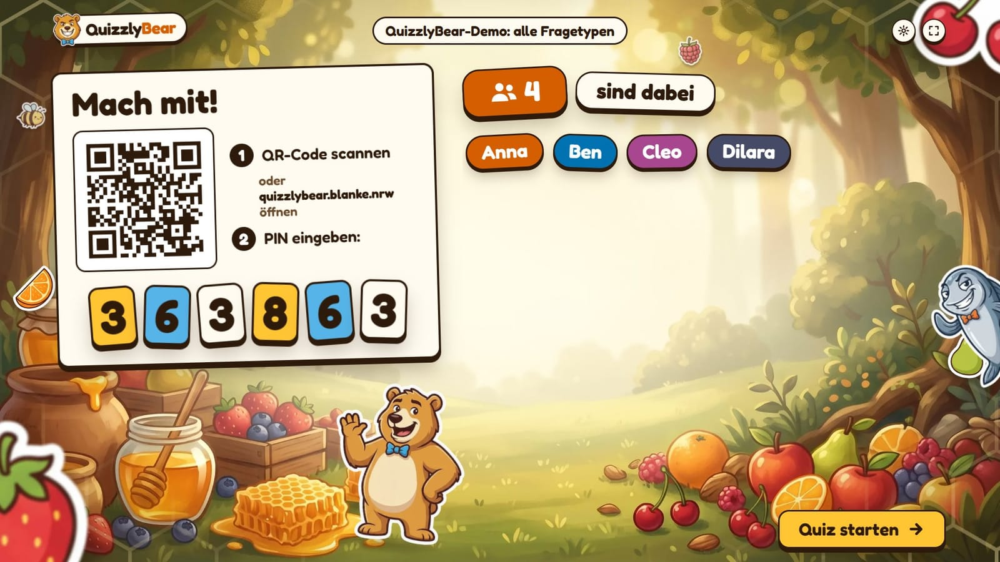
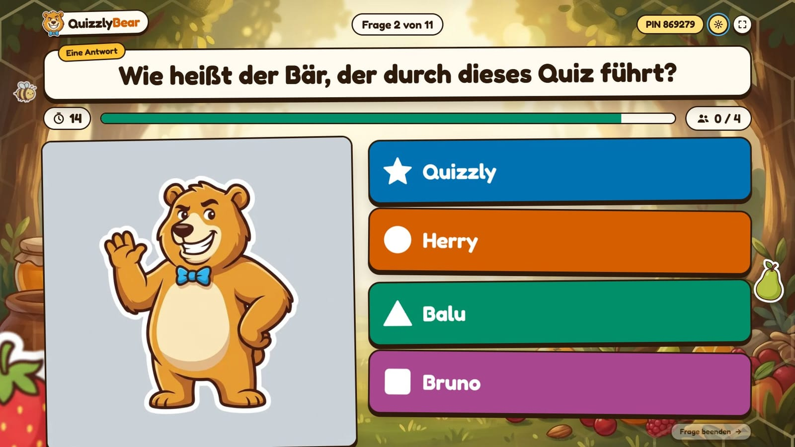
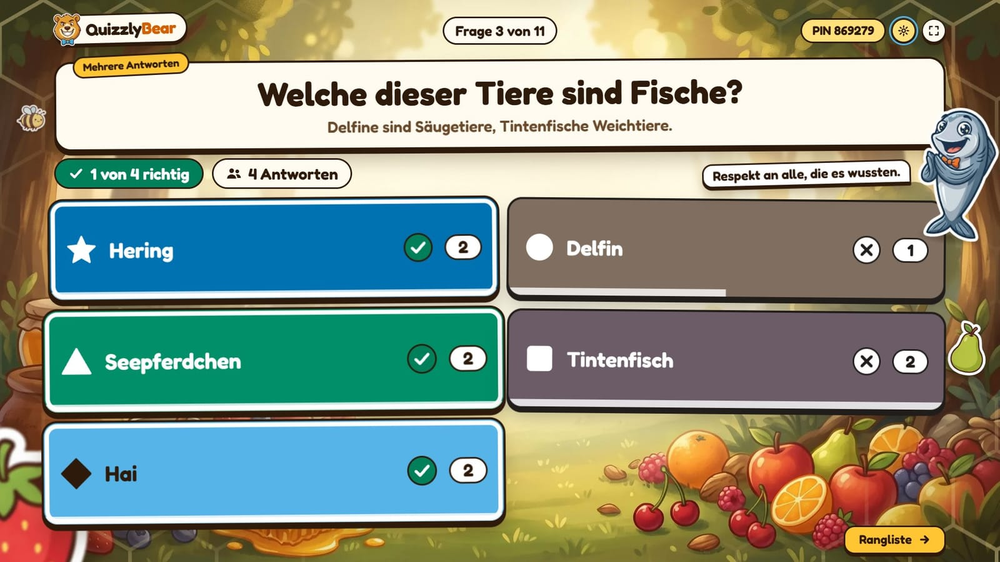
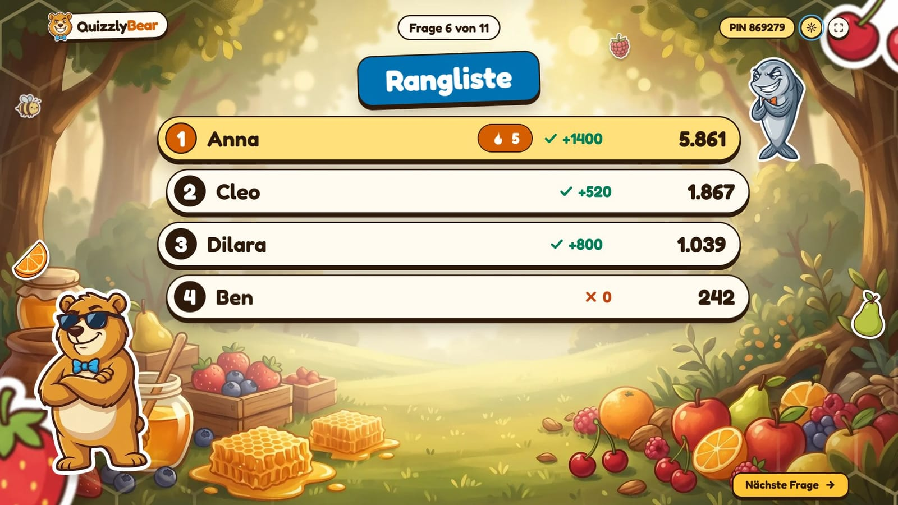
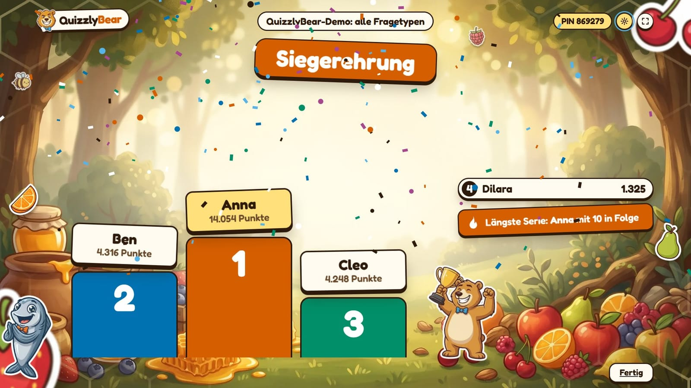
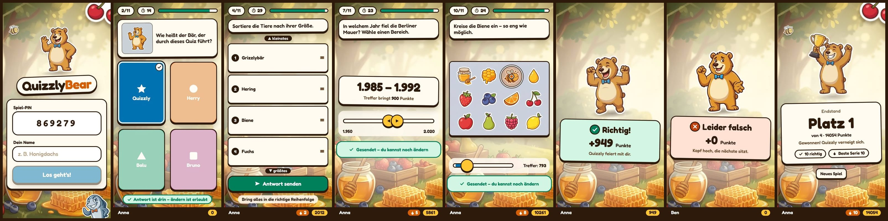

# QuizzlyBear

Live-Quiz für Kollegenrunden: Die Fragen laufen auf dem großen Bildschirm, geantwortet wird mit dem
Handy. Durch die Runde führen Quizzly, der Quizzlybär, und sein frecher Partner Herry, der Hering.



| | |
| --- | --- |
|  |  |
|  |  |



## Was es kann

- **Drei Rollen:** Host-Screen (`/host/`, für 16:9 bis 4K), Spieler am Handy (`/`, Hochformat),
  Quizmaster (`/admin/`, Login, Quizze hochladen, Runden starten).
- **Neun Fragetypen:** eine Antwort, mehrere Antworten, Reihenfolge, Paare, Schätzfrage, Bereich,
  Punkt setzen, Kreis ziehen, Umfrage. Ein Umfrage-Ergebnis kann Lösung einer späteren Frage sein.
  Bei „Punkt setzen“ kann das Ziel ein Punkt oder eine Fläche sein, etwa ein Land auf einer Karte;
  die Quizmaster-Seite hat dafür einen Koordinaten-Helfer.
- **Farbe plus Symbol:** Jede Antwortoption hat eine feste Farbe und ein festes Symbol. Richtig und
  falsch tragen immer Haken oder Kreuz. Die Palette ist an Okabe-Ito angelehnt.
- **Antworten sind änderbar.** Es zählt die letzte Antwort samt ihrer Zeit. Gesperrt wird, wenn die
  Zeit um ist oder alle geantwortet haben.
- **Serie:** Richtige Antworten in Folge werden gezählt und angezeigt, auf Wunsch mit Bonuspunkten.
- **Reconnect:** Spieler-ID und Token liegen im Handy. Nach Funkloch oder Neuladen bekommt das Handy
  den vollständigen Zustand zurück: Phase, Restzeit, Punkte, abgegebene Antwort.
- **Über die quiz.json steuerbar:** ob die Frage auch auf dem Handy erscheint, die
  Siegerreihenfolge bei der Siegerehrung, Gleichstands-Regeln, Serien-Bonus. Der Host kann die
  Handy-Anzeige zusätzlich im laufenden Spiel umschalten (Zahnrad oben rechts).

## Loslegen (lokal)

Voraussetzung: Node.js 22.23.5, 24.22.3 oder neuer (ältere Versionen starten lokal mit einer Warnung).

```bash
npm install
npm run seed      # Quizmaster „demo“ / „demodemo“ und das Demo-Quiz mit allen Fragetypen
npm run dev       # Server auf :3000, Oberfläche auf http://localhost:5173
```

1. `http://localhost:5173/admin/` öffnen, als `demo` anmelden, beim Demo-Quiz „Spiel starten“.
2. Der Host-Screen zeigt PIN und QR-Code. Handys im selben WLAN scannen den Code; lokal zeigt der
   QR-Code automatisch auf die LAN-Adresse des Rechners.
3. Weiter geht es mit der Leertaste, Enter oder dem Knopf unten rechts. `F` schaltet Vollbild.

Eigenen Quizmaster anlegen: `npm run user:add -- <name> <passwort> [--admin]`.

## Quiz erstellen

Hochgeladen wird auf der Quizmaster-Seite, entweder als ZIP (`quiz.json` + Ordner `img/`) oder als
reine `quiz.json` mit Bild-URLs. Fehler werden mit Fundstelle erklärt.

- Formatbeschreibung, auch als Vorlage für eine KI: [schema/quiz-format.md](schema/quiz-format.md)
- JSON-Schema: [schema/quiz.schema.json](schema/quiz.schema.json)
- Beispiel mit allen Typen: [examples/demo](examples/demo)

Beispiel für die Einstellungen:

```json
"settings": {
  "phone": { "showQuestion": true, "showAnswerText": true },
  "streak": { "bonus": 100, "max": 500 },
  "ranking": { "reveal": [3, 2, 1], "tiebreak": ["correct", "time", "streak"], "top": 5 }
}
```

`ranking.reveal` ist die Siegerreihenfolge: die Plätze in der Reihenfolge, in der der Host sie
bei der Siegerehrung enthüllt. Handys auf einem dieser Plätze sehen ihren Platz erst, wenn er auf
dem großen Bildschirm enthüllt ist.

## Aufbau

```
src/
  shared/     Datenmodell, Socket-Protokoll, Punkteformeln, Rangliste
  types/      ein Ordner je Fragetyp: logic.ts (Schema, Prüfung, Punkte), Player.svelte, Host.svelte
  server/     Express + Socket.io, Spiel-Engine, Login, Quiz-Import, Bildverarbeitung
  web/        Vite-Wurzel mit drei getrennten Einstiegen: Handy, Host, Quizmaster
schema/       quiz.schema.json (generiert), Formatbeschreibung, Beispiel
examples/     Demo-Quiz als Quelle
art/src/      Quellbilder der Figuren, Sticker und des Hintergrunds
scripts/      Asset-Build, Schema-Build, Seed, Browser-Durchlauf
deploy/       Compose, deploy.sh und nginx für den Server
```

**Spielablauf** (`src/server/game/game.ts`): Lobby → je Frage Countdown (3 s) → Frage → Sperre →
Auflösung → Rangliste → … → Siegerehrung. Der Server ist ein Zustandsautomat und schickt bei jedem
Phasenwechsel den vollständigen Zustand.

**Timing:** Die Frage geht schon mit dem Countdown an die Geräte. Aufgedeckt wird lokal. Das Handy
misst die Antwortdauer mit `performance.now()` vom Erscheinen der Antworten bis zum Tap und schickt
sie mit. Nach Ablauf der Zeit nimmt der Server noch eine Sekunde lang rechtzeitig getippte Antworten an.

**Neuer Fragetyp:** Ordner in `src/types/` anlegen (`logic.ts`, `Player.svelte`, `Host.svelte`),
in `index.ts`, `player.ts`, `host.ts` und `labels.ts` eintragen, den Typnamen in
`src/shared/quiz.ts` ergänzen, `npm run build:schema` ausführen.

## Gestaltung und Grafik

- Der Host-Screen ist eine Bühne von 120 × 67,5 rem. `1 rem` wächst mit dem Bildschirm (Full HD:
  16 px, 4K: 32 px), dadurch bleibt alles scharf und gleich proportioniert.
- Animiert wird nur über `transform` und `opacity`. Unschärfe und Schlagschatten der Deko-Sticker
  sind in die WebP-Dateien eingerechnet, im Browser läuft dafür kein Filter.
- Hintergrund in Ebenen: gemaltes Motiv, Licht und Vignette, Waben als Eck-Akzent, Sticker in drei
  Tiefenebenen. Während Frage und Auflösung sind höchstens drei Sticker zu sehen.
- **Bilder ergänzen oder tauschen:** Quellbild nach `art/src/` legen und `npm run build:assets`
  ausführen. `bg-*.jpg` wird zum Hintergrund (Host 16:9, Handy als Hochformat-Ausschnitt),
  `sheet-*.jpg` wird in Einzelsticker zerlegt. Welche Sticker wo schweben, steht in
  `src/web/lib/deco.ts`.
- **Stimmungen:** Welche Figur mit welchem Spruch auf ein Ergebnis reagiert, steht in
  `src/web/lib/moods.ts`. Die Figuren freuen sich mit, staunen oder leiden mit; ausgelacht wird
  niemand. Die Auswahl wechselt je Frage und Spieler.
- **Figuren-Animationen:** Sieben Posen bewegen sich (Quizzly winkt, jubelt, grübelt, stemmt den
  Pokal; Herry winkt, grinst fies, schwimmt). Jede ist ein 4×4-Raster aus 16 Einzelbildern als
  WebP, abgespielt per CSS-Keyframe mit Sprüngen. Das kostet keinen Video-Decoder und keinen Filter;
  die Bildabstände auf dem Host sind mit und ohne Animation gleich (`scripts/measure-anim.mjs`).
  Neue Animation: Pose mit `node scripts/anim-start.mjs <pose>` als Startbild im Videoformat
  aufbereiten, daraus ein kurzes Video mit unverändertem hellgrauem Hintergrund erzeugen, als
  `art/video/<pose>.mp4` ablegen, mit `node scripts/build-anim.mjs --analyze <pose>` eine nahtlose
  Schleife suchen, in `art/video/anims.json` eintragen und `node scripts/build-anim.mjs` ausführen.
  Die Videos selbst liegen nicht im Repo.

## Befehle

| Befehl | Zweck |
| --- | --- |
| `npm run dev` | Server und Oberfläche mit automatischem Neuladen |
| `npm test` | Unit-Tests: Punktefunktionen aller Typen, Spiel-Engine, Import, Validierung |
| `npm run check` | Typprüfung für TypeScript und Svelte |
| `npm run build` / `npm start` | Produktions-Build bauen und starten |
| `npm run build:schema` | Schema und Beispiel-ZIP neu erzeugen |
| `npm run build:assets` | Grafiken aus `art/src` freistellen und als WebP schreiben |
| `node scripts/build-anim.mjs` | Figuren-Animationen aus `art/video` bauen (braucht ffmpeg) |
| `node scripts/measure-anim.mjs` | Bildabstände auf dem Host mit und ohne Animation messen |
| `node scripts/playthrough.mjs` | komplette Runde im Browser (Edge) durchspielen, Screenshots nach `screenshots/` |

Der Browser-Durchlauf bedient jeden Fragetyp wirklich, lädt ein Handy mitten in der Frage neu und
bricht bei Konsolenfehlern ab. Mit `--4k` läuft der Host in 3840 × 2160.

## Sicherheit

- **Node-Version:** Im Produktionsmodus startet der Server nur mit einer Node-Version ab dem
  Sicherheits-Release vom 11.11.2026 (22.23.5, 24.22.3, 26.13.1). Anlass ist CVE-2026-111497
  („Node2Shell“), ein Speicherfehler im Brotli-Decoder von Node. Das Docker-Image ist auf
  `node:24.22.3` festgeschrieben. Lokal gibt es bei älterem Node nur eine Warnung.
- **Keine Dekompression fremder Daten:** Komprimierte Anfragen lehnt der Server mit 415 ab. Bild-URLs
  werden ohne automatische Dekompression geladen. Socket-Nachrichten laufen unkomprimiert.
- **Bilder:** Nur JPEG, PNG, WebP, GIF und AVIF, erkannt an der Dateisignatur. SVG, TIFF und HEIF
  erreichen die Bildbibliothek nicht. Höchstens 60 Megapixel je Bild.
- **Bild-URLs:** Ziele im internen Netz, andere Ports als 80 und 443 und Adressen mit Zugangsdaten
  werden abgelehnt. Verbunden wird mit genau der Adresse, die vorher geprüft wurde.
- **Uploads:** Nur für angemeldete Quizmaster. Höchstens 40 MB, entpackt 100 MB und 600 Dateien.
- **Anmeldung:** Passwörter mit scrypt gehasht, Sitzungen als HttpOnly-Cookie (SameSite=Lax, im
  Produktionsmodus Secure). Acht Fehlversuche je Adresse in zehn Minuten, dann Pause. Ein
  Passwortwechsel beendet alle Sitzungen des Kontos.
- **Spielbetrieb:** Kontingente je Verbindung für Beitritt und Antworten, eine Bremse gegen das
  Durchprobieren von PINs, höchstens 250 Spieler je Spiel, zehn Spiele je Quizmaster.
- **Bewusst nicht abgesichert:** Mitspielen braucht nur die PIN, und die Antwortzeit misst das Handy
  selbst. Wer schummeln will, kann das. So war es für Kollegenrunden gewünscht.

Geprüft wird das meiste davon in `src/server/hardening.test.ts`.

## Umgebungsvariablen

| Variable | Standard | Bedeutung |
| --- | --- | --- |
| `PORT` | 3000 | Port des Servers |
| `DATA_DIR` | `./data` | SQLite-Datei und Bilder |
| `PUBLIC_URL` | (leer) | Adresse für QR-Code und Anzeige, z. B. `https://quizzlybear.blanke.nrw` |
| `TRUST_PROXY` | (aus) | `1` hinter einem Reverse Proxy |
| `ADMIN_USER`, `ADMIN_PASSWORD` | (leer) | legen beim ersten Start einen Admin an, solange es keinen Benutzer gibt |
| `MAX_UPLOAD_MB` | 40 | Obergrenze für Uploads |

## Deployment

Siehe [deploy/README.md](deploy/README.md).
